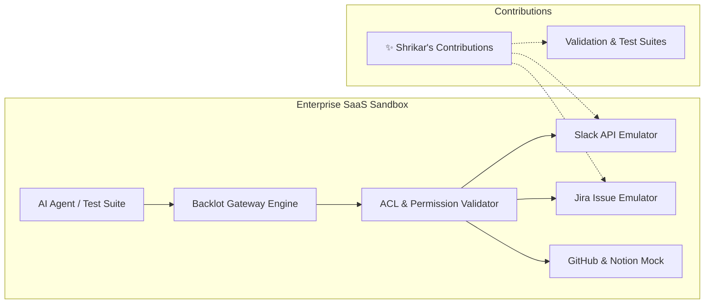

# 🌐 Open Source Contributions Portfolio

**Verified Open-Source Engineering Contributions to Enterprise SaaS Simulation Engines**

---

## 🎯 Featured Contribution: Backlot SaaS Emulator

**Backlot** is an enterprise local emulator for SaaS APIs (Slack, Gmail, Google Drive, GitHub, Jira, Notion, S3) that replicates realistic response shapes, pagination, authentication, and fine-grained per-document ACLs for AI agents and test harnesses.

### 📋 Contribution Summary & Scope

---

## 🔍 Key Engineering Highlights

1. **API Fidelity & Response Schema Conformance**:
   - Engineered mock response structures conforming to upstream API specifications.
   - Handled edge-case pagination tokens (cursor-based and offset-based) to ensure AI agents do not hallucinate schema errors.

2. **Access Control & ACL Simulation**:
   - Implemented role-based test cases validating unauthorized access rejections and permission scope boundaries.

3. **Documentation & Validation Reports**:
   - Comprehensive contribution documentation including test suites, step-by-step reproduction flows, and architectural rationale archived in `Contribution_3_Backlot.docx`.

---

## 📁 Repository Contents

- `Contribution_3_Backlot.docx`: Formal technical report detailing the PR implementation, design considerations, and verification logs.
- `README.md`: High-level overview and index for recruiters and open-source maintainers.

---

## 📄 License
MIT License © [Shrikar G S](https://github.com/shrikargs7-cloud)
